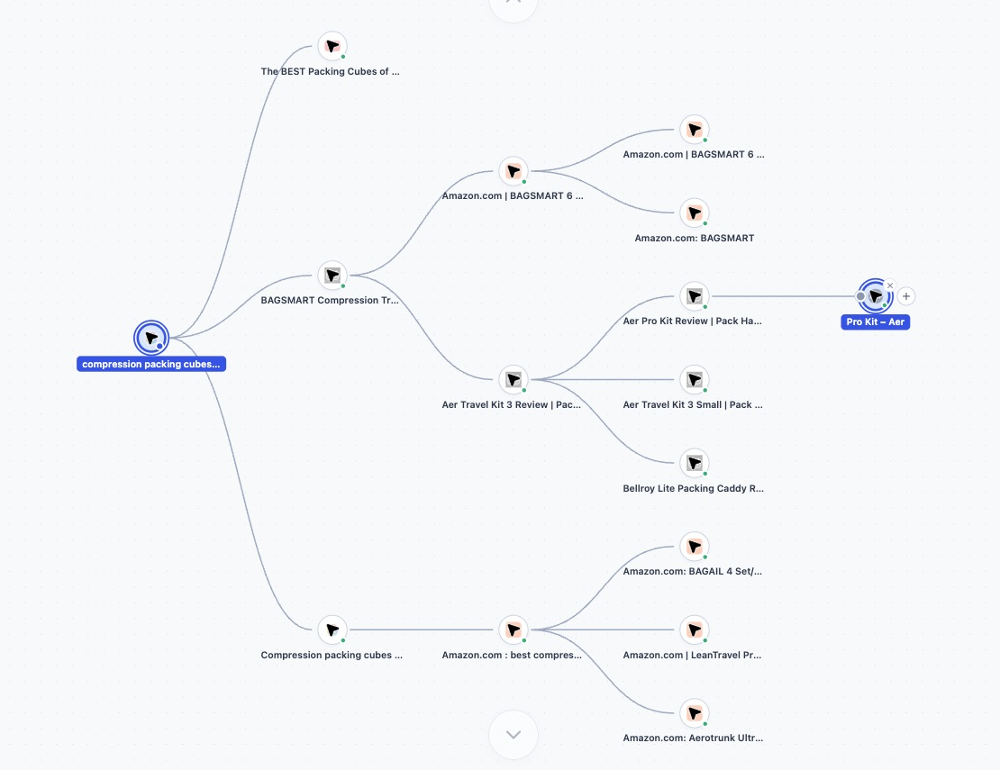
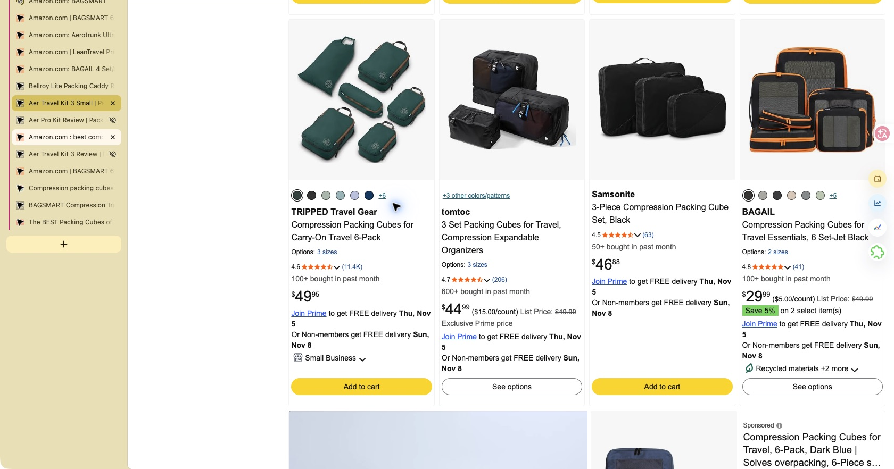
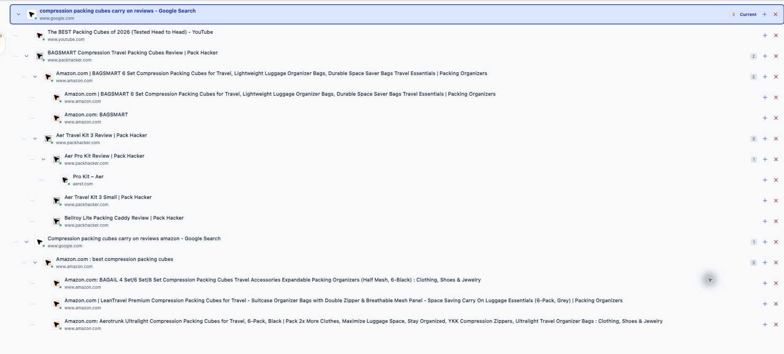
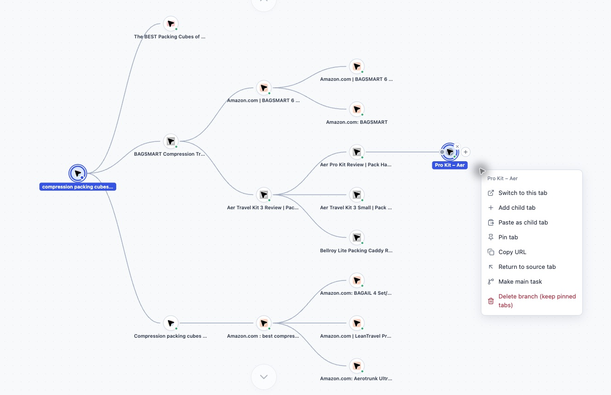
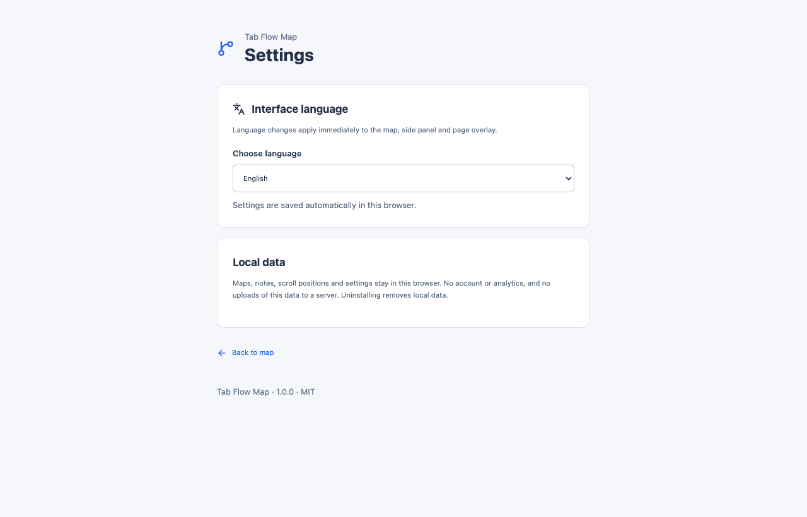
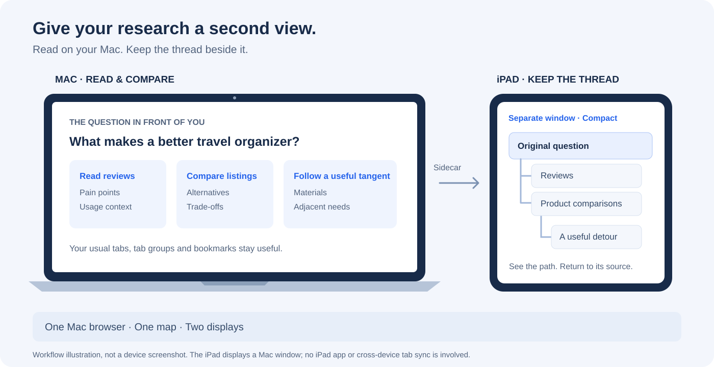

# Tab Flow Map

**Follow a tangent. Find your way back.**

Map the connections between your browser tabs, keep the original question in view, and return to the page where your research started.

**An optional view for clearer thinking, alongside your browser's native controls.** Keep using the tab bar, tab groups, pinned tabs and bookmarks as usual. Open the map when you need to understand how pages connect or recover your train of thought; it does not replace those tools.

[](LICENSE)


[中文说明](README.zh-CN.md) · [How to use](#how-to-use-it) · [Tips](#small-habits-that-keep-research-clear) · [Install](#install) · [Privacy](PRIVACY.md) · [Support](#support-the-project)



*Compact mode, captured from the running extension. [Full application screenshot](docs/screenshots/research-map-full-en.png).*

## The core: browse normally, branches form automatically

**You do not have to operate the map to build the map.** Once recording is on, stay on the websites you are researching. Open links or continue researching something you copied, and Tab Flow Map connects the new tab to its source page automatically.

| What you do on a website | What appears in the map |
| --- | --- |
| Open a link from page A in a new tab, using a normal click that opens a tab, a middle-click, or **Open link in new tab**. | The new page becomes a child branch of A. |
| Copy a keyword or phrase from A, open a new tab, then paste it into a supported address-bar search or a website's search field. | When the copied text matches, the new tab is connected to A. |
| Copy a URL from A, open a new tab, then paste it into the address bar and visit it. | The matching destination is connected back to A. |

Continue from the new page and the next branch follows it: **review → product page → search for a term copied from that product page**. Leave the map visible beside your browser, or look at it when you need to find your way back. Clicking **+** or drawing connections in the map is optional.

Copy-based connections use matching content within the new tab's first three tracked actions. Copying something and opening an unused blank tab alone does not establish a source relationship.

## Why I built this

I was researching a product idea. I opened a few websites to understand one need, followed a review, compared another product, and found an interesting discussion. That discussion led to a different question. A few more tabs later, I could no longer find the page I started with.

Everything was still open. My train of thought was gone.

Which review sent me here? Was I comparing products, looking for complaints, or checking a material? What was the original question? Reopening the tabs one by one meant repeating the research just to remember why I had done it.

Tab Flow Map grew out of that problem. It keeps the source relationship between tabs visible, so a useful detour has a path back. Add a short note to the starting page, explore a branch, and return to the question you meant to answer.



## A real example: researching a better travel organizer

The screenshots follow an actual English-language browsing session about compression packing cubes for carry-on travel. The research branches into product listings, independent reviews, videos and related packing problems.

These are real screenshots of the extension and actual research tabs. Images are cropped to focus on the product and omit browser chrome or location details; no interface text, nodes or results were fabricated. See [the screenshot notes](docs/SCREENSHOTS.md).

The point of the example is the browsing process. It is not a product recommendation or a claim that the research proves market demand.

| What happens during research | How to keep the thread |
| --- | --- |
| A review sends you to a product listing, then to a competing product. | Keep that chain connected to the review that prompted it. |
| Packing cubes lead to questions about zippers, materials or toiletry bags. | Explore the new branch while retaining its source. |
| You forget whether you were checking compression, organization or price. | Return to the starting node and read the note with your original question. |
| The map gets busy. | Collapse a branch, search for a page, or use the tree view. |

<details>
<summary>See the same session as a source tree</summary>



</details>

## How to use it

1. **Start with a question.** Open your starting page, click the extension icon, then **Start exploring**. Give the workflow a name such as “Carry-on packing cubes: buyer needs.”
2. **Keep working on your websites.** Open links in new tabs, or copy a keyword or URL from the current page and use it to search or visit a page in a new tab. Recognized link and copy sources automatically become parent–child branches; you do not need to return to the map for each step.
3. **Look at the map when you need context.** Click a page title to return to that tab. In **Compact** mode, right-click a node and choose **Return to source tab**. In Detailed view, use **Return to source** or the source path. You can also search the map or collapse a branch to focus on the question at hand.
4. **Add context only when useful.** To save a note, switch to **Detailed**, select a node, open **Details**, and use **Findings / next steps**. For manual organization, use a node's **+** to create a child tab, add a starting point from the canvas menu, or drag **+** to another node's connector to adjust its source.



Use **Compact** for an overview, **Detailed** for notes and context, and **Tree** for a readable hierarchy. The canvas menu switches between the browser side panel, a separate window and an overlay on the page.

<details>
<summary>Language settings</summary>



</details>

The gear button opens settings. Choose English, Simplified Chinese, Japanese, or the browser's language. Changes apply to the map and open overlays immediately.

### Tab actions affect real tabs

A node represents a browser tab. Navigating within that tab updates the same node. Closing a tab removes its node and reconnects surviving children. Deleting a branch closes its ordinary tabs; pinned tabs survive canvas deletion. Undo can restore supported actions, and native browser tab restoration reconnects its source when it can be identified.

The map represents your tab relationships. It is not a permanent archive of every page you visited. Pause recording when you want to stop adding new browsing branches. Uninstalling removes the extension's local data.

## Small habits that keep research clear

### Mac + iPad: read on one screen, keep the thread on the other

Keep the research pages on your Mac and the Compact map on an iPad beside it. You can follow a long review or compare listings while keeping the original question and its branches visible.



*A workflow illustration, not a device screenshot.*

1. Connect a compatible Mac and iPad with **Sidecar**, using the iPad as an **extended display**. Both devices need the same Apple Account. Follow [Apple's setup and compatibility guide](https://support.apple.com/en-us/102597).
2. In the map's display menu, choose **Separate window**, then **Compact** view. Drag that window to the iPad display; leave the browser pages on the Mac.
3. Browse with your Mac's keyboard and mouse or trackpad. Glance at the map to find a branch, then select a page or use **Return to source tab** when you need to go back.

The extension still runs in Chrome or Edge **on the Mac**. The iPad displays that Mac window; it does not run the extension or sync a separate iPad browser. The same window arrangement also works with an ordinary second monitor.

### More ways to use the map

| When you want to… | Try this |
| --- | --- |
| Stay focused on a single screen | Keep **Compact** in the side panel while reading. Use **Page overlay** for a quick look at the map, or **Separate window** when you have room beside the browser. |
| Stop a useful tangent from becoming the whole task | Put one question on the starting node: “Why do carry-on travelers buy packing cubes?” Follow the tangent, then return to that source before choosing the next branch. |
| Compare options without mixing up the evidence | Start each alternative from the same comparison page using its node's **+**. Keep separate branches for different products; add notes to distinguish an observation, a hypothesis and a next step. You can adjust a source connection manually when needed. |
| Read deeply without losing the overview | Browse in **Compact**. Switch to **Detailed** to write a note, or **Tree** to read a deep hierarchy. Collapse branches you are not working on; deletion also affects real tabs. |
| Take a detour into unrelated work | Choose **Pause recording** before opening unrelated tabs, then **Resume recording** when you return to the research. |
| Leave a useful starting point for tomorrow | Add a short note: “Question / What I learned / Next step.” Bookmark the sources you want to keep with the browser's normal bookmarks; the map follows live tabs rather than archiving every page. |

**A quick exercise:** choose one buyer question, open three sources, follow one interesting detour, then return to the starting node and write one finding and one next step. The map helps you see the route; deciding which evidence answers the question is still your work.

**Handy shortcut:** with focus in the map and an undoable action available, press **⌘Z** on Mac or **Ctrl+Z** on Windows/Linux. While editing a note or search field, normal text editing keeps its own shortcuts.

## Install

The release target is Chrome and Chromium-based Edge, using Manifest V3.

Download the extension ZIP from [GitHub Releases](https://github.com/TideSparrow/TabFlowMap/releases/latest). These downloads are for manual installation; a GitHub release is separate from browser-store approval.

**From a packaged ZIP:** unzip the extension package, open `chrome://extensions` or `edge://extensions`, enable Developer mode, choose **Load unpacked**, and select the folder containing `manifest.json`. Click the Tab Flow Map icon to open the side panel.

**From source:** use Node.js 22.12+ and the pnpm version pinned in `package.json`.

```sh
corepack enable
pnpm install
pnpm build
```

Load `.output/chrome-mv3/` as the unpacked extension. For development, run `pnpm dev`.

## Features and privacy

- Automatic source branches while you browse: links opened in new tabs and matching copied text or URLs used in a new tab.
- Compact, detailed and tree views; horizontal and vertical canvas layouts.
- Search, notes, branches, manual connections, multi-selection and undo.
- Side panel, separate map window and draggable page overlay.
- Pinned tabs, drag-to-create tasks, pinning and reordering.
- Source tracking for real links, matching copied text and supported address-bar searches.
- Native tab restoration and browser-restart recovery.
- English, Simplified Chinese and Japanese.

The graph, notes, scroll positions and preferences stay in your browser. The extension has no account system, analytics or backend. It needs access to ordinary HTTP(S) pages for source capture, scroll restoration and the page overlay. Incognito access is disabled, and password fields are skipped.

Opening a website or searching creates normal browser requests. Searches created from the map use Google. Browser-internal and extension pages have tracking restrictions. See [PRIVACY.md](PRIVACY.md) for the data handled and the reason for each permission.

## For contributors

All application source lives under `src/`:

```text
src/
  entrypoints/        WXT entrypoints: background, tracker, map, panel and settings
  background/         Browser events, tab operations, undo and recovery
  content/            Page capture, source tracking and floating map host
  components/         Map views, controls, menus and tab nodes
  hooks/              React state and interaction hooks
  core/               Graph, source relationships and layout rules
  storage/            Persistent graph data and canvas positions
  types/              Shared data and message types
  i18n/               English, Simplified Chinese and Japanese catalogs
  testing/            Browser fixtures shared by module tests
  mount-map.tsx       Shared React mounting for the map views
public/               Extension icons and native manifest translations
test/                 Standalone storage and language tests
scripts/              Source audits and reproducible source packaging
docs/                 Real screenshots and publishing instructions
```

`entrypoints` follows the [WXT convention](https://wxt.dev/guide/essentials/entrypoints) and contains thin entrypoints. Application modules are organized directly under `src/` by responsibility; a separate feature wrapper is unnecessary for this single-purpose extension.

The background manager serializes graph changes. Durable data uses `browser.storage.local`; live tab bindings and undo entries use `browser.storage.session`. Feature tests sit beside the modules they exercise. The root `test/` directory covers standalone storage and language settings.

```sh
pnpm check
pnpm build
pnpm zip
pnpm audit:source
```

The build produces `.output/chrome-mv3/`. Packaging produces an extension ZIP and a `*-sources.zip` archive containing code, tests, screenshots, documentation and the lockfile. Environment files, private keys, local browser profiles and generated build output are excluded. See [the publishing guide](docs/PUBLISHING.md).

Preserve tab-source precedence and recovery behavior when contributing. Update all three catalogs when adding UI text. The project uses the [MIT license](LICENSE); dependencies retain their licenses and [notices](THIRD_PARTY_NOTICES.md). Keep React Flow's attribution visible.

## Support the project

If Tab Flow Map helps you keep your research on track, you can buy the creator a coffee to support open-source maintenance, bug fixes and documentation.

[](https://buymeacoffee.com/marklongpcm)

[Read the Tab Flow Map story](https://buymeacoffee.com/marklongpcm/tab-flow-map-find-way-back-research-turns-many-tabs).

**Topics:** `browser-extension` · `chrome-extension` · `tab-manager` · `mind-map` · `research` · `product-research` · `local-first` · `react` · `typescript` · `wxt`
