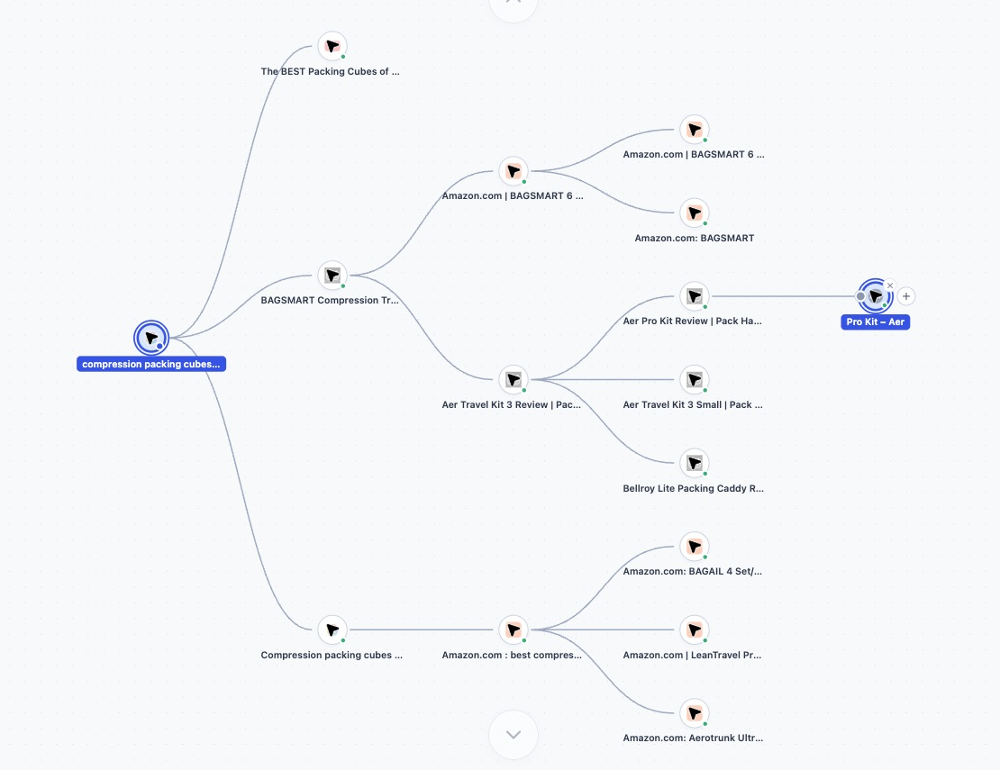
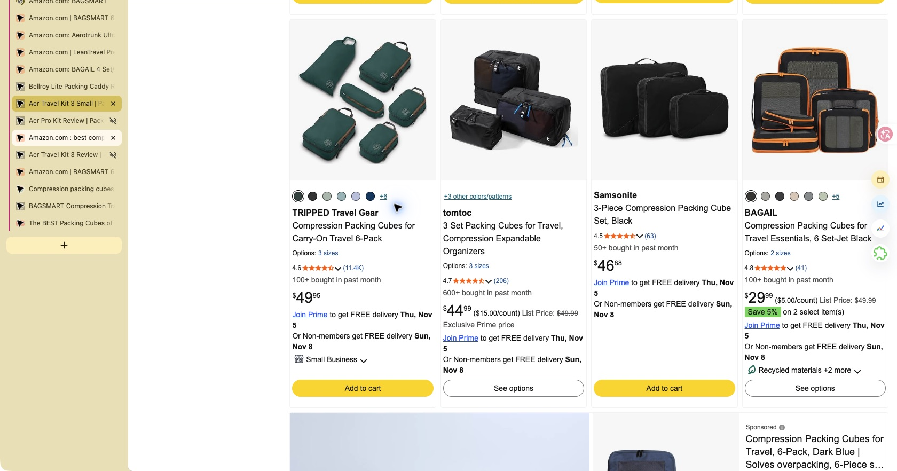
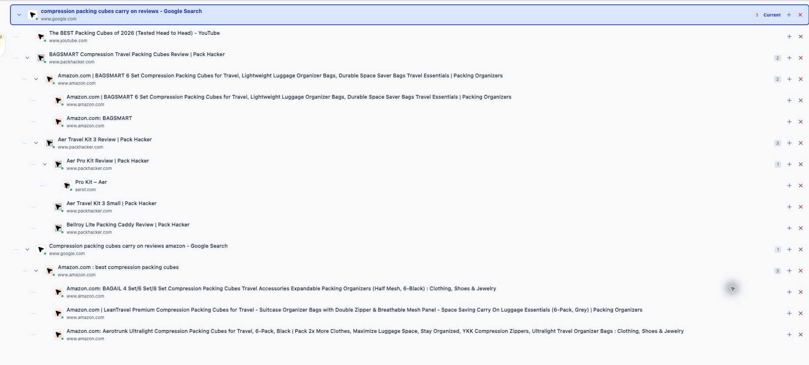
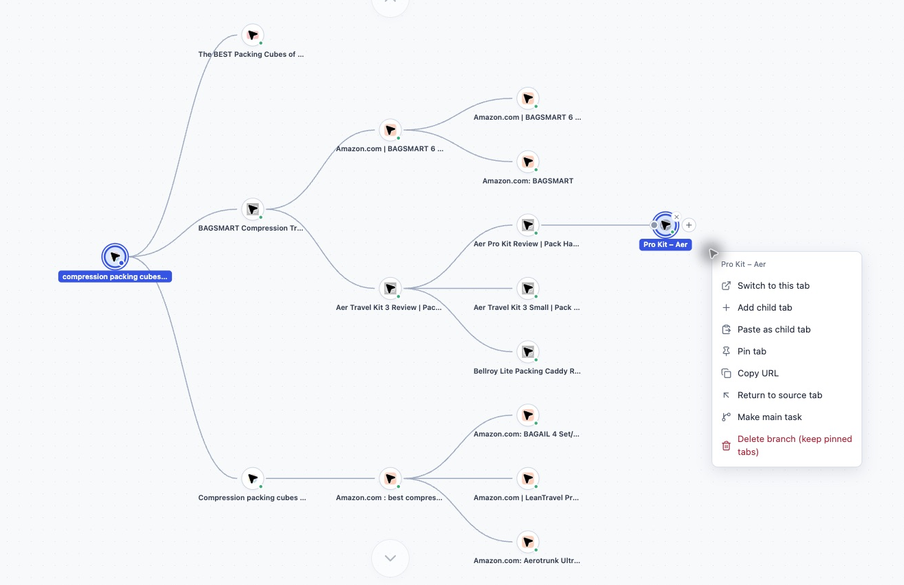
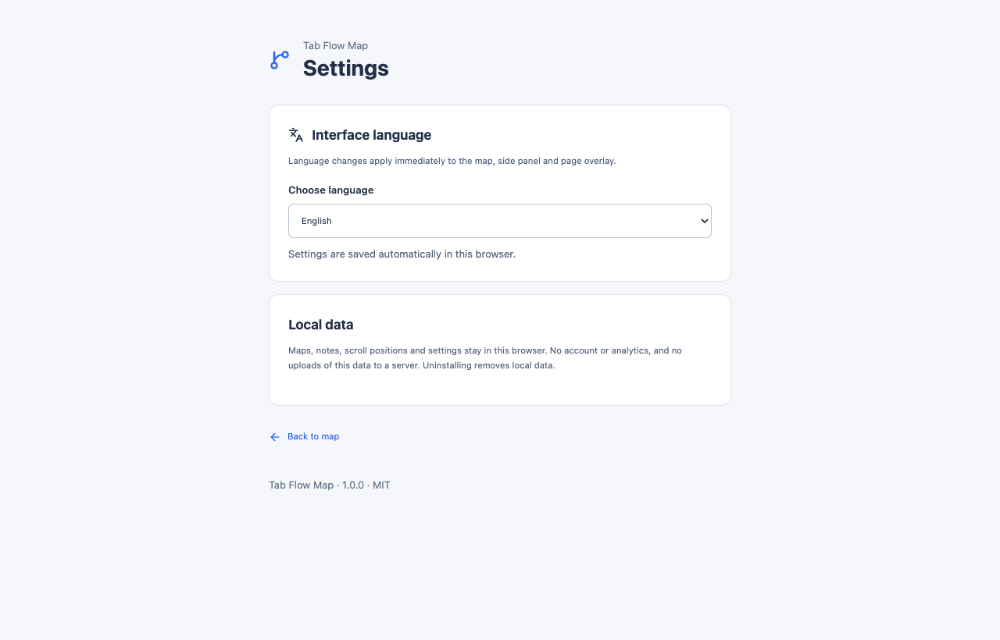
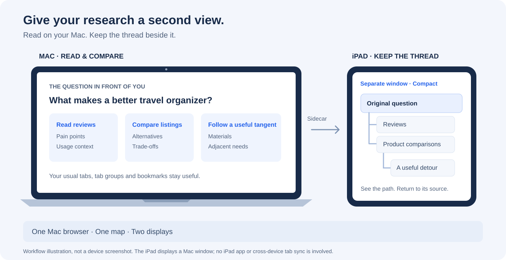

# Tab Flow Map · 标签导图

**沿着分支探索，也能回到最初的问题。**

把浏览器标签之间的来路画出来。在需求调研、选品和资料搜集时，记住自己为什么打开这个页面，以及该从哪里接着想。

**这是一种理清思路的增强模式，不是替代浏览器原生组件。** 标签栏、标签组、固定标签和书签照常使用；需要梳理页面之间的来源、看清探索分支或找回思路时，再打开导图。

[](LICENSE)


[English](README.md) · [如何使用](#如何使用) · [使用小技巧](#使用小技巧) · [安装](#安装) · [隐私说明](PRIVACY.md) · [支持项目](#支持项目)



*运行中的插件实拍，以 Compact 精简模式为主。[查看完整应用截图](docs/screenshots/research-map-full-en.png)。*

## 核心功能：照常浏览，自动形成来源分支

**不用为了画导图，先去操作导图。** 开启记录后，继续在当前网站上阅读、复制、搜索和打开链接，插件会自动识别新标签的来源，把它接成原页面的子分支。

| 你在网页中照常做的事 | 导图自动发生的变化 |
| --- | --- |
| 从页面 A 点击会打开新标签的链接、用鼠标中键打开链接，或选择“在新标签页中打开链接”。 | 新页面成为 A 的子分支。 |
| 在 A 复制一个关键词或一段文字，新建标签后，粘贴到支持的地址栏搜索或网站搜索框中继续查找。 | 匹配到复制内容后，新标签自动关联到 A。 |
| 在 A 复制一个网址，新建标签后粘贴到地址栏并访问。 | 匹配到的网址页面自动关联到 A。 |

到了新页面还可以继续往下走，例如：**评测文章 → 商品详情 → 用商品页复制的词搜索新资料**。可以把导图一直放在旁边看，也可以等思路乱了再回来看；不需要每开一个标签，就到导图里点一次 **+** 或手动连线。

复制关联会在新标签的前三步追踪操作内核对内容。只是复制一下、打开空白标签，却没有使用复制内容，不会直接认定为子分支。

## 为什么做这个插件

最开始，我只是想调研一个需求。

为了弄明白 A 问题，打开了几个网站。一篇评测提到了另一个产品，于是去看商品详情；评论里又出现了新的使用场景，再去搜一搜。看着看着，开始比较材料、价格、配件，顺手又打开几个竞品。

等到想回头时，标签栏已经挤满了。最开始那个页面找不到了，也想不起来刚才为什么会走到这里。到底是在验证需求，还是已经变成随便逛网站？资料都还在，思路却断了。

一个个点开标签重新看，相当于为了回忆刚才做过什么，又把调研走了一遍。

Tab Flow Map 就是为这个问题做的：保留标签之间的来源关系。你可以顺着有价值的线索继续走，也可以沿着分支回到最初的问题。再给起点写一条简短的备注，下次回来时，就知道自己原本要弄清楚什么。



## 真实场景：调研旅行收纳袋的用户需求

截图来自实际打开网页进行的一次英文调研，问题是：随身行李里的压缩收纳袋，究竟解决什么问题？从 Google 出发，逐渐分成商品搜索、独立评测、视频和相邻收纳需求。

截图来自实际运行的插件和真实打开的网页，只做了聚焦应用区域、去掉浏览器工具栏或位置细节的裁剪，没有伪造界面文字、节点或调研结果。[截图说明](docs/SCREENSHOTS.md)中记录了场景和处理方式。

这组截图展示的是浏览与整理过程，不代表商品推荐，也不表示仅凭这些页面就已经验证了市场需求。

| 调研中常见的情况 | 在导图里怎么继续 |
| --- | --- |
| 从评测跳到商品，又开始比较另一款产品。 | 保留这条分支，知道比较是从哪篇评测开始的。 |
| 收纳袋引出了拉链、材料或洗漱包的新问题。 | 继续探索子分支，保留它与原问题的关系。 |
| 忘了刚才是在看压缩效果、分类收纳，还是价格。 | 回到起点，读一眼最初写下的调研目标。 |
| 页面越来越多，暂时不想看某一条线索。 | 折叠这条分支、搜索页面，或切到树状视图。 |

<details>
<summary>补充：展开查看同一次调研的树状视图</summary>



</details>

## 如何使用

1. **从一个问题开始。** 打开起始页面，点击插件图标，在侧边栏中点击 **Start exploring**，给线路起一个名字，例如 `Carry-on packing cubes: buyer needs`。
2. **继续在网站上做事。** 从链接打开新标签，或在当前页面复制关键词、网址，再到新标签中搜索或访问。识别到的链接与复制来源会自动连成父子分支，不用每一步都回到导图操作。
3. **需要理清思路时再看导图。** 点击标题返回对应标签；在 **Compact** 模式下，右键节点，选择 **Return to source tab**；在 Detailed 视图中，可以使用 **Return to source** 或来源路径。也可以搜索或折叠分支来找回主线。
4. **需要时再补充备注或手动整理。** 写备注时，切到 **Detailed**，选择节点，打开 **Details**，在 **Findings / next steps** 中保存。也可以用节点的 **+** 创建子标签、从画布菜单添加新起点，或把 **+** 拖到另一个节点的连接点来调整来源。



**Compact** 适合看全局，**Detailed** 适合看备注和上下文，**Tree** 适合逐层阅读。画布菜单可以切换侧边栏、独立窗口和网页悬浮三种展示方式。

<details>
<summary>补充：语言设置</summary>



</details>

点击齿轮进入设置。支持英文、简体中文、日文和跟随浏览器，切换后会立即同步到导图和已打开的悬浮窗。为便于对照按钮，中英文 README 使用同一组英文界面截图。

### 导图操作会影响真实标签

一个节点对应一个浏览器标签。在同一标签内跳转会更新原节点；关闭标签会移除节点，并让仍打开的子标签保留与上层的关系。删除分支会关闭对应的普通标签，画布删除会保留固定标签。支持的操作可以撤销；浏览器原生恢复关闭标签时，会在能够识别来源的情况下接回原节点。

导图表达标签之间的关系，不是完整浏览历史存档。不想继续添加浏览分支时，可以暂停记录。卸载插件会删除它的本地数据。

## 使用小技巧

### Mac + iPad：一边读资料，一边看思路

Mac 上保留正在阅读的评测、商品和资料页，把 Compact 导图放到旁边的 iPad 上。读长文或对比商品时，最初的问题和已经走过的分支始终在视线里，不用反复切换窗口找起点。



*这是工作方式示意图，不是设备实拍。图中文字统一使用英文。*

1. 用 **Sidecar（随航）** 将兼容的 iPad 设为 Mac 的**扩展显示器**，两台设备登录同一 Apple 账户。具体设置和兼容条件见 [Apple 官方说明](https://support.apple.com/zh-cn/102597)。
2. 在导图的显示方式菜单选择 **Separate window**，切到 **Compact**，再把独立导图窗口拖到 iPad 屏幕。资料页留在 Mac 上。
3. 继续使用 Mac 的键盘、鼠标或触控板浏览。想回头时，看一眼旁边的分支，选择目标页面，或使用 **Return to source tab** 回到来源。

插件仍然运行在 **Mac 的 Chrome 或 Edge** 中，iPad 只是展示 Mac 窗口，不是在 iPad 浏览器安装插件，也不是同步两台设备的标签。同样的窗口搭配也适用于普通外接显示器。

### 其他值得试试的用法

| 想解决什么问题 | 可以怎么搭配 |
| --- | --- |
| 只有一块屏幕，也想边读边理思路 | 用侧边栏的 **Compact** 保留概览；临时看一眼关系时用 **Page overlay**，桌面空间足够时用 **Separate window** 放到浏览器旁边。 |
| 支线很有意思，但总会忘记主任务 | 在起点写一句问题，例如“为什么随身行李用户会买压缩收纳袋？”探索完一条支线，先回来源，再决定下一条路。 |
| 比较几个产品时，证据混在一起 | 从同一个比较起点，用节点的 **+** 分别打开不同方案，让每款产品有自己的分支。备注里区分“观察到的现象 / 待验证的猜想 / 下一步”，需要时手动调整来源连接。 |
| 深挖细节，又不想失去全局 | 平时用 **Compact**，写备注时切 **Detailed**，层级很深时切 **Tree**。暂时不研究的分支先折叠；删除操作也会影响真实标签。 |
| 调研到一半，要去处理无关工作 | 打开无关标签前先点 **Pause recording**，回到调研后再点 **Resume recording**。 |
| 今天先停，明天能接着想 | 给起点留三行：“问题 / 已知结论 / 下一步”。值得长期保留的资料仍用原生书签收藏；导图跟随真实标签，不承担完整网页存档。 |

**可以马上试一次：** 选一个用户问题，打开三个资料来源，允许自己探索一条有意思的支线，再回到起点写下一条发现和一个下一步。导图帮你看清走过的路，哪些证据真正回答了问题，仍需要自己判断。

**一个顺手的快捷键：** 焦点在导图中、且有可撤销操作时，Mac 按 **⌘Z**，Windows/Linux 按 **Ctrl+Z**。编辑备注或搜索框时，保留文字输入本身的快捷键行为。

## 安装

发布目标为 Chrome 和基于 Chromium 的 Edge，使用 Manifest V3。

从 [GitHub Releases](https://github.com/TideSparrow/TabFlowMap/releases/latest) 下载插件 ZIP，按下方步骤手动安装。GitHub 版本发布与浏览器商店审核是独立流程。

**使用安装包：** 解压插件 ZIP，打开 `chrome://extensions` 或 `edge://extensions`，开启开发者模式，点击“加载已解压的扩展程序”，选择包含 `manifest.json` 的目录。点击 Tab Flow Map 图标即可打开侧边栏。

**从源码构建：** 需要 Node.js 22.12+，pnpm 版本以 `package.json` 中固定的版本为准。

```sh
corepack enable
pnpm install
pnpm build
```

加载 `.output/chrome-mv3/`。开发时使用 `pnpm dev`。

## 功能与数据

- 正常浏览时自动接成来源分支：链接打开的新标签，以及在新标签中使用匹配的复制文字或网址。
- 精简、完整、树状视图，横向与纵向画布布局。
- 搜索、备注、分支、手动连线、框选和撤销。
- 侧边栏、独立窗口、可拖动的网页悬浮窗。
- 固定标签管理、排序、拖拽创建独立任务。
- 真实链接来源、匹配的复制文字和支持的地址栏搜索关联。
- 浏览器原生关闭恢复和重启恢复。
- 中文、英文、日文。

导图、备注、滚动位置和偏好保存在本地浏览器。插件没有账号系统、统计追踪或服务端，需要普通 HTTP(S) 网页权限来记录来源、恢复位置和展示悬浮窗。禁止无痕访问，跳过密码输入框。

主动打开网站或搜索会产生正常浏览请求；从导图输入搜索词默认使用 Google。浏览器内部页和扩展页存在追踪限制。各项权限和数据处理详见 [PRIVACY.md](PRIVACY.md)。

## 代码结构与贡献

所有应用源码都位于 `src/`：

```text
src/
  entrypoints/        WXT 插件入口：后台、内容脚本、导图、侧边栏和设置
  background/         浏览器事件、标签操作、撤销与恢复
  content/            页面采集、来源追踪和悬浮导图宿主
  components/         导图视图、控制栏、菜单和标签节点
  hooks/              React 状态与交互 hooks
  core/               图谱、来源关系和布局规则
  storage/            图谱持久化与画布位置存储
  types/              共用数据与消息类型
  i18n/               英文、简体中文、日文翻译
  testing/            模块测试共用的浏览器模拟
  mount-map.tsx       导图视图共用的 React 挂载入口
public/               插件图标和浏览器原生语言资源
test/                 独立存储与语言设置测试
scripts/              源码审计与可重复的源码打包
docs/                 真实截图与发布说明
```

`entrypoints` 遵循 [WXT 的入口约定](https://wxt.dev/guide/essentials/entrypoints)，只负责接入。应用代码按职责直接展开在 `src/` 下；这个插件只有一个核心功能，不再额外包一层功能目录。

后台管理器串行处理图谱变更。长期数据使用 `browser.storage.local`，实时标签绑定和撤销记录使用 `browser.storage.session`。功能测试放在对应模块旁，根目录 `test/` 覆盖独立存储和语言设置。

```sh
pnpm check
pnpm build
pnpm zip
pnpm audit:source
```

输出包含可加载目录、插件 ZIP 和 `*-sources.zip` 源码包。源码包包括代码、测试、截图、文档和锁文件，排除环境文件、私钥、本地浏览器数据和构建产物。发布步骤见 [发布指南](docs/PUBLISHING.md)。

贡献时请保留来源判定优先级和恢复行为，新增界面文字需要更新三种语言。项目采用 [MIT 协议](LICENSE)，并保留[第三方许可](THIRD_PARTY_NOTICES.md)与 React Flow 署名。

## 支持项目

如果 Tab Flow Map 帮你找回过一次调研思路，欢迎请开发者喝杯咖啡，支持开源工具维护、问题修复和文档改进。

[](https://buymeacoffee.com/marklongpcm)

[阅读 Tab Flow Map 的开发故事](https://buymeacoffee.com/marklongpcm/tab-flow-map-find-way-back-research-turns-many-tabs)。

**标签：** `browser-extension` · `chrome-extension` · `tab-manager` · `mind-map` · `research` · `product-research` · `local-first` · `react` · `typescript` · `wxt`
