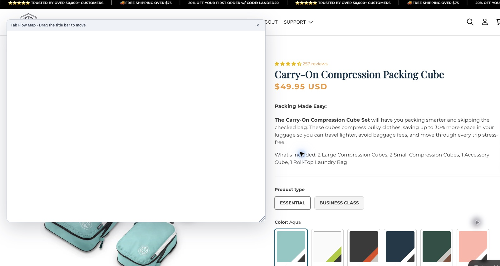
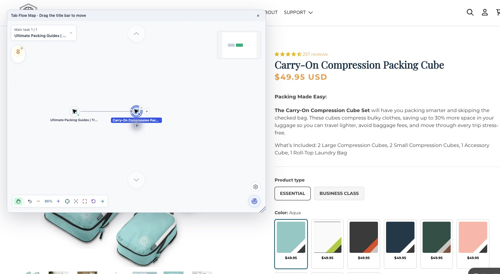
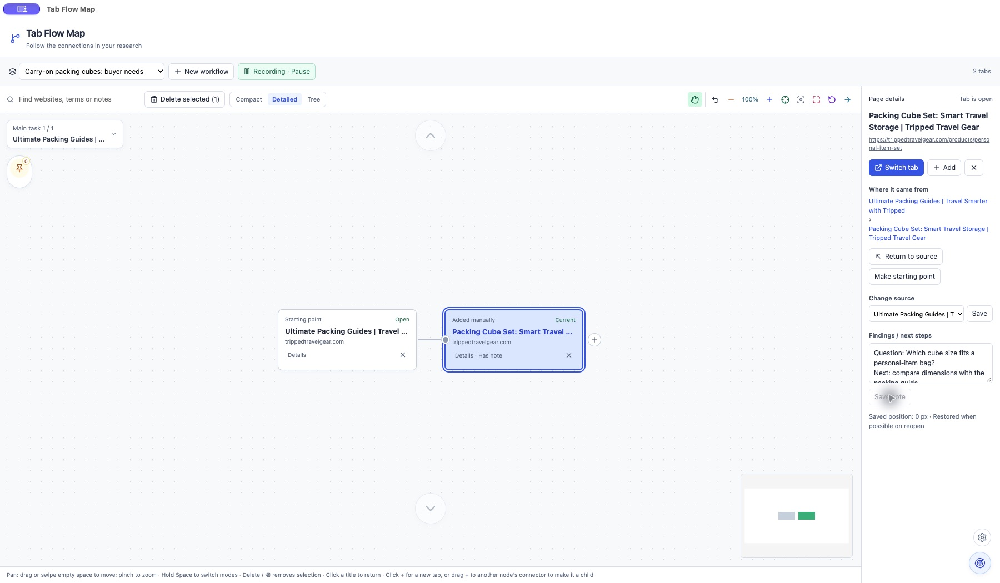
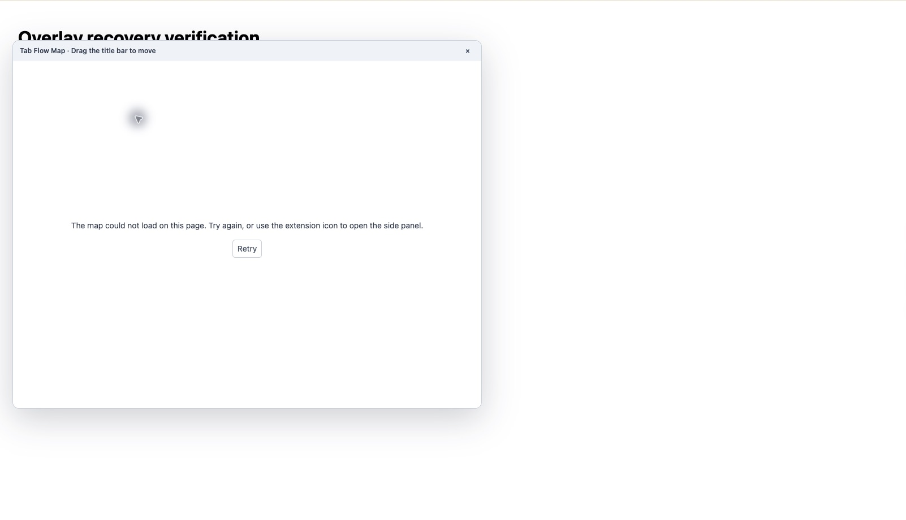

# v1.0.1 blank-screen verification

Verified on 2026-11-04 in desktop Chrome on macOS, using the built extension loaded through Chrome's unpacked-extension workflow. The installed version was confirmed as 1.0.1. These checks concern the local build; they do not indicate store approval.

## Reproduced cause

The v1.0.0 overlay on [the carry-on product page](https://trippedtravelgear.com/products/carry-on-set) had a correct extension `src` **and an unexpected empty `srcdoc` attribute**. The accessibility tree identified the embedded document as `about:srcdoc`, and the overlay body was blank. This establishes the immediate cause; the specific host script or other extension that added the attribute was not identified.



The frame monitor now removes unexpected `srcdoc` from its own iframe, accepts readiness only from that iframe and the extension origin, limits automatic repair to three attempts, and presents a retry action if loading fails. It does not remove sandbox or site security policies, or change unrelated frames.

Language preference reads no longer block initial map rendering. A failed preference read keeps the browser language without writing over saved data. A React error boundary displays a localized recovery action instead of unmounting the whole map into an empty window.

## Actual Chrome checks

| Check | Result |
| --- | --- |
| Open overlay on the original carry-on product page | Passed: map and controls render; the embedded document is the extension page. |
| Navigate to packing guides and another real product page | Passed: overlays load after navigation. |
| Create a child tab through the map and visit a real product URL | Passed: parent-child connection appears. |
| Return to the original failure page after interference tests | Passed: the overlay renders again with its source connection. |
| Open a separate map window | Passed: actual tab nodes and source connection render. |
| Refresh that map window | Passed: map remains usable. |
| Close the window, reopen it from the side panel | Passed: source connection is retained. |
| Switch Compact → Detailed → Tree → Compact | Passed: all views render, including the same source hierarchy. |
| Save a note in Detailed, refresh the window | Passed: the note and two tab nodes are retained. |
| Switch side panel → overlay → window → side panel → window → overlay | Passed. |





The separate window did not have the same reproduced `srcdoc` fault. Its startup hardening and the positive checks above were verified independently; this report does not attribute the overlay's host interference to the separate window.

## Controlled interference in actual Chrome

The developer fixture [overlay-interference.html](../../test/fixtures/overlay-interference.html) deliberately applies the same DOM mutation. It contains no seeded map data. Serve it locally with:

```sh
python3 -m http.server 8766 --bind 127.0.0.1 --directory test/fixtures
```

Open `http://127.0.0.1:8766/overlay-interference.html`, enable the overlay, then use the page buttons:

| Scenario | Result |
| --- | --- |
| **Blank map once** | Passed: the extension document automatically reappears with its map. |
| **Interfere continuously** | Passed: automatic attempts stop and a localized error with **Retry** appears. |
| **Stop interference**, then **Retry** in the overlay | Passed: the extension document and original source connection reappear. |



These are deliberate developer tests, separate from the real product-page reproduction. Screenshots are actual captures; browser chrome was cropped where needed. UI text and nodes were not composited or replaced.

## Automated checks and limits

- `pnpm check`: 23 test files, 223 tests passed; type checking and source audit passed.
- All 281 translation keys match across English, Simplified Chinese and Japanese.
- Regression tests cover empty `srcdoc` recovery, bounded repair, readiness origin/source validation, timeout/retry, disposal, language changes during overlay startup, failed preference reads, and render-error fallback.
- Failed preference reads and render exceptions were injected in automated DOM tests, rather than by corrupting the user's live Chrome storage.

Browser startup/render recovery is not a guarantee that every website permits embedded extensions. A page that still cannot display the overlay shows a recovery message; the side panel and separate window remain available. No permission expansion or map-storage migration is required for this patch.
